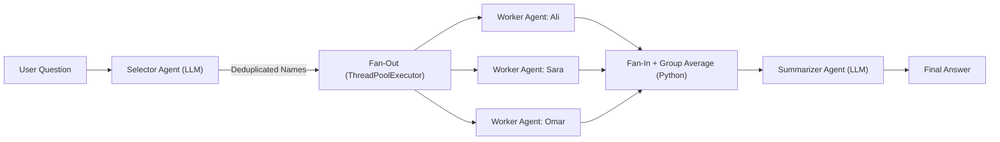

# Parallelization Agent: Student Grade Calculator

> [!info] Minimap
> - **Pattern:** Fan-out independent subtasks concurrently → fan-in results → synthesize final answer
> - **Flow:** `Question → Selector (LLM) → Fan-Out (ThreadPoolExecutor) → Independent Worker Agents → Fan-In + Group Average → Summarizer (LLM) → Answer`
> - **Core Idea:** When subtasks do not depend on each other, run isolated worker agents in parallel to cut wall-clock latency, then aggregate their outputs.
> - **Best For:** Batch analysis, multi-document summarization, or evaluating multiple independent entities simultaneously.
> - **Trade-off:** Significantly lower latency than sequential loops, but only works for independent tasks and requires isolated agent state per thread.

---

## Architecture



---

## Code

```python
import os
import json
from openai import OpenAI
from dotenv import load_dotenv

# --- Client & Model Setup ---
load_dotenv()  # Load NVIDIA_API_KEY from .env
client = OpenAI(
    base_url="https://integrate.api.nvidia.com/v1",
    api_key=os.getenv("NVIDIA_API_KEY")
)
MODEL = "nvidia/nemotron-3.5-lightning-30b-a3b"


# --- Minimal Stateful LLM Wrapper ---
class Agent:
    def __init__(self, system=""):
        self.messages = [{"role": "system", "content": system}]

    def __call__(self, message):
        self.messages.append({"role": "user", "content": message})
        result = self.execute()
        self.messages.append({"role": "assistant", "content": result})
        return result

    def execute(self):
        completion = client.chat.completions.create(
            model=MODEL, temperature=0.0, messages=self.messages
        )
        return completion.choices[0].message.content or ""


# --- Local Data & Deterministic Tools ---
student_marks_db = {
    "ali": [88, 92, 79, 85],
    "sara": [95, 89, 91, 87],
    "omar": [72, 65, 80, 70],
}


def student_marks(name):
    name = name.strip().lower()
    if name not in student_marks_db:
        raise ValueError(f"Unknown student: {name}")
    return student_marks_db[name][:]


def calculate_average(marks):
    return sum(marks) / len(marks)


def parse_json(response):
    # Permit a JSON code fence, but reject malformed output.
    response = response.strip()
    if response.startswith("```"):
        response = response.split("\n", 1)[1].rsplit("```", 1)[0]
    return json.loads(response)


def student_result(name):
    marks = student_marks(name)
    return {"student": name, "marks": marks,
            "average": calculate_average(marks)}


def summarize(question, results):
    agent = Agent("You are a teacher. Answer using only the supplied results. "
                  "Do not invent marks or averages.")
    return agent(json.dumps({"question": question, "results": results}))


# --- PATTERN: Fan-out -> independent agents concurrently -> fan-in ---
from concurrent.futures import ThreadPoolExecutor


def analyze_student(name):
    # Compute ground-truth marks and average for one student
    evidence = student_result(name)

    # Each worker has its own Agent and conversation history (thread-safe isolation)
    worker = Agent("You are a teacher. Write one short assessment of this student "
                   "using only the provided marks and average.")
    assessment = worker(json.dumps(evidence))
    return {**evidence, "assessment": assessment}


def query(question, max_workers=3):
    # 1. SELECT: Identify which independent entities need to be processed
    selector = Agent('Select the students relevant to the question. Known students: '
                     'ali, sara, omar. For the whole class select all three. '
                     'Return a JSON array of lowercase names only.')
    names = parse_json(selector(question))

    # Validate names against known DB entries and deduplicate while keeping order
    if not isinstance(names, list) or not names or any(
            not isinstance(name, str) or name not in student_marks_db for name in names):
        raise ValueError("Invalid student selection")
    names = list(dict.fromkeys(names))
    print("Fan-out:", names)

    # 2. FAN-OUT: Run analyze_student concurrently across threads
    with ThreadPoolExecutor(max_workers=max_workers) as executor:
        results = list(executor.map(analyze_student, names))
    print("Fan-in:", results)

    # 3. FAN-IN: Aggregate worker outputs and compute the group average
    evidence = {"students": results, "group_average": calculate_average(
        [item["average"] for item in results])}

    # 4. SYNTHESIZE: Produce one cohesive final answer
    return summarize(question, evidence)


if __name__ == "__main__":
    print(query("Analyze each student's performance and give the class average."))
```

---

## How It Works (Minimap Breakdown)

1. **Select (`selector`):** Chooses the relevant students as a JSON array, validates every name against `student_marks_db`, and deduplicates with `dict.fromkeys()`.
2. **Fan-Out (`ThreadPoolExecutor`):** Dispatches `analyze_student(name)` concurrently; each thread creates its own `Agent` instance so conversation histories never collide.
3. **Fan-In (`evidence`):** Collects all individual assessments and computes `group_average` deterministically in Python.
4. **Summarize (`summarize`):** Combines the parallel assessments and group average into one final response.

---

## Example Trace

```text
Fan-out: ['ali', 'sara', 'omar']
Fan-in: [
  {'student': 'ali', 'marks': [88, 92, 79, 85], 'average': 86.0, 'assessment': '...'},
  {'student': 'sara', 'marks': [95, 89, 91, 87], 'average': 90.5, 'assessment': '...'},
  {'student': 'omar', 'marks': [72, 65, 80, 70], 'average': 71.75, 'assessment': '...'}
]
Sara leads with an average of 90.5, Ali is solid at 86.0, and Omar averages 71.75. The class average is 82.75.
```

---

## Paper Reference

> [!quote] Reference
> **An LLM Compiler for Parallel Function Calling**
> Sehoon Kim, Suhong Moon, Ryan Tabrizi, Nicholas Lee, Michael W. Mahoney, Kurt Keutzer, Amir Gholami (ICML 2024)
> [arXiv:2312.04511](https://arxiv.org/abs/2312.04511)
>
> *Connection:* Shows how dispatching independent tool/agent calls in parallel instead of sequentially yields major speedups and cost reductions while preserving accuracy.
