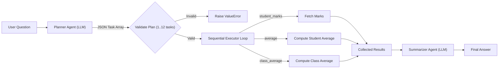

# Plan-and-Execute Agent: Student Grade Calculator

> [!info] Minimap
> - **Pattern:** Upfront planning → deterministic sequential execution → grounded synthesis
> - **Flow:** `Question → Planner (LLM) → Ordered JSON Plan → Executor (Python) → Summarizer (LLM) → Answer`
> - **Core Idea:** Separate *deciding what to do* (planning) from *doing it* (execution) so multi-step dependencies run in a fixed, auditable order.
> - **Best For:** Predictable multi-step tasks where later steps depend on earlier results (e.g., fetch marks → student averages → class average).
> - **Trade-off:** Lower LLM call overhead than step-by-step ReAct, but cannot adapt the plan mid-execution if an unexpected result appears.

---

## Architecture



---

## Code

```python
import os
import json
from openai import OpenAI
from dotenv import load_dotenv

# --- Client & Model Setup ---
load_dotenv()  # Load NVIDIA_API_KEY from .env
client = OpenAI(
    base_url="https://integrate.api.nvidia.com/v1",
    api_key=os.getenv("NVIDIA_API_KEY")
)
MODEL = "nvidia/nemotron-3.5-lightning-30b-a3b"


# --- Minimal Stateful LLM Wrapper ---
class Agent:
    def __init__(self, system=""):
        # Initialize conversation with a role-defining system prompt
        self.messages = [{"role": "system", "content": system}]

    def __call__(self, message):
        # Append user input, query the model, and store the reply in history
        self.messages.append({"role": "user", "content": message})
        result = self.execute()
        self.messages.append({"role": "assistant", "content": result})
        return result

    def execute(self):
        # temperature=0.0 keeps planning and JSON formatting deterministic
        completion = client.chat.completions.create(
            model=MODEL, temperature=0.0, messages=self.messages
        )
        return completion.choices[0].message.content or ""


# --- Local Data & Deterministic Tools ---
student_marks_db = {
    "ali": [88, 92, 79, 85],
    "sara": [95, 89, 91, 87],
    "omar": [72, 65, 80, 70],
}


def student_marks(name):
    # Normalize input and return a copy so callers cannot mutate the DB
    name = name.strip().lower()
    if name not in student_marks_db:
        raise ValueError(f"Unknown student: {name}")
    return student_marks_db[name][:]


def calculate_average(marks):
    return sum(marks) / len(marks)


def parse_json(response):
    # Permit a JSON code fence, but reject malformed output.
    response = response.strip()
    if response.startswith("```"):
        response = response.split("\n", 1)[1].rsplit("```", 1)[0]
    return json.loads(response)


def student_result(name):
    marks = student_marks(name)
    return {"student": name, "marks": marks,
            "average": calculate_average(marks)}


def summarize(question, results):
    # Ground the final response strictly in computed Python results
    agent = Agent("You are a teacher. Answer using only the supplied results. "
                  "Do not invent marks or averages.")
    return agent(json.dumps({"question": question, "results": results}))


# --- PATTERN: Planner -> ordered tasks -> executor -> final answer ---
# Each task may depend on results from earlier tasks.

def query(question):
    # 1. PLAN: Ask the LLM for a strict JSON array of ordered subtasks
    planner = Agent(
        'Create an ordered plan as a JSON array of objects. '
        'Allowed tasks: {"action":"student_marks","student":"ali"}, '
        '{"action":"average","student":"ali"}, '
        '{"action":"class_average"}. '
        'Fetch marks before computing each average. Compute class average last '
        'only if requested. Known students: ali, sara, omar. JSON only.'
    )
    plan = parse_json(planner(question))

    # Guard against empty, non-list, or runaway plans
    if not isinstance(plan, list) or not 1 <= len(plan) <= 12:
        raise ValueError("Invalid plan")
    print("Plan:", json.dumps(plan, indent=2))

    # 2. EXECUTE: Run each planned step deterministically in order
    marks, averages, results = {}, {}, {}
    for task in plan:
        action = task["action"]
        name = task.get("student", "").lower()
        print("Executing:", task)

        if action == "student_marks":
            marks[name] = student_marks(name)
        elif action == "average":
            # Depends on marks[name] having been fetched in an earlier step
            averages[name] = calculate_average(marks[name])
        elif action == "class_average":
            # Depends on individual averages having been computed first
            results["class_average"] = calculate_average(list(averages.values()))
        else:
            raise ValueError(f"Unknown action: {action}")

    results.update(marks=marks, averages=averages)
    print("Results:", results)

    # 3. SYNTHESIZE: Turn structured results into a natural-language answer
    return summarize(question, results)


if __name__ == "__main__":
    print(query("What is each student's average and the class average?"))
```

---

## How It Works (Minimap Breakdown)

1. **Plan (`planner`):** Converts the natural-language question into an ordered JSON task list constrained to 3 allowed actions (`student_marks`, `average`, `class_average`).
2. **Validate (`parse_json` + length check):** Strips optional markdown fences, parses JSON, and enforces `1 <= len(plan) <= 12`.
3. **Execute (`for task in plan`):** Runs pure Python functions sequentially—passing state via `marks` → `averages` → `results` without extra LLM calls.
4. **Summarize (`summarize`):** A fresh `Agent` formats the verified numbers into the final answer without inventing data.

---

## Example Trace

```text
Plan: [
  {"action": "student_marks", "student": "ali"},
  {"action": "student_marks", "student": "sara"},
  {"action": "student_marks", "student": "omar"},
  {"action": "average", "student": "ali"},
  {"action": "average", "student": "sara"},
  {"action": "average", "student": "omar"},
  {"action": "class_average"}
]
Results: {'class_average': 82.75, 'marks': {...}, 'averages': {'ali': 86.0, 'sara': 90.5, 'omar': 71.75}}
Ali's average is 86.0, Sara's average is 90.5, Omar's average is 71.75, and the class average is 82.75.
```

---

## Paper Reference

> [!quote] Reference
> **Plan-and-Solve Prompting: Improving Zero-Shot Chain-of-Thought Reasoning by Large Language Models**
> Lei Wang, Wanyu Xu, Yihuai Lan, Zhiqiang Hu, Yunshi Lan, Roy Ka-Wei Lee, Ee-Peng Lim (ACL 2023)
> [arXiv:2305.04091](https://arxiv.org/abs/2305.04091)
>
> *Connection:* Formalizes splitting reasoning into an explicit **devising a plan** phase followed by **carrying out the plan** sequentially to eliminate missing-step and calculation errors.
