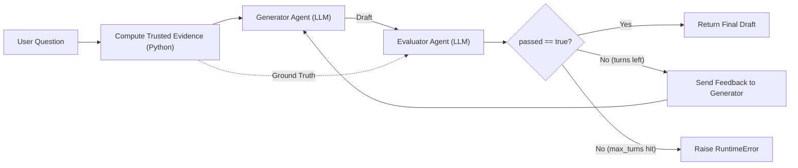

# Reflection Agent: Student Grade Calculator

> [!info] Minimap
> - **Pattern:** Generate → critique against trusted evidence → revise → repeat until pass
> - **Flow:** `Question + Evidence → Generator (LLM) → Draft → Evaluator (LLM) → Pass? → Final Answer (or Feedback Loop)`
> - **Core Idea:** Pair a **Generator** with an **Evaluator** that checks drafts against ground-truth computed values, forcing targeted revisions before returning an answer.
> - **Best For:** High-accuracy outputs (math, comparisons, reports, code) where a single pass may miss details or make subtle mistakes.
> - **Trade-off:** Improves reliability and completeness, but adds extra LLM turns (latency and token cost) per revision cycle.

---

## Architecture



---

## Code

```python
import os
import json
from openai import OpenAI
from dotenv import load_dotenv

# --- Client & Model Setup ---
load_dotenv()  # Load NVIDIA_API_KEY from .env
client = OpenAI(
    base_url="https://integrate.api.nvidia.com/v1",
    api_key=os.getenv("NVIDIA_API_KEY")
)
MODEL = "nvidia/nemotron-3.5-lightning-30b-a3b"


# --- Minimal Stateful LLM Wrapper ---
class Agent:
    def __init__(self, system=""):
        # Keeps full message history so the generator remembers earlier drafts
        self.messages = [{"role": "system", "content": system}]

    def __call__(self, message):
        self.messages.append({"role": "user", "content": message})
        result = self.execute()
        self.messages.append({"role": "assistant", "content": result})
        return result

    def execute(self):
        completion = client.chat.completions.create(
            model=MODEL, temperature=0.0, messages=self.messages
        )
        return completion.choices[0].message.content or ""


# --- Local Data & Deterministic Tools ---
student_marks_db = {
    "ali": [88, 92, 79, 85],
    "sara": [95, 89, 91, 87],
    "omar": [72, 65, 80, 70],
}


def student_marks(name):
    name = name.strip().lower()
    if name not in student_marks_db:
        raise ValueError(f"Unknown student: {name}")
    return student_marks_db[name][:]


def calculate_average(marks):
    return sum(marks) / len(marks)


def parse_json(response):
    # Permit a JSON code fence, but reject malformed output.
    response = response.strip()
    if response.startswith("```"):
        response = response.split("\n", 1)[1].rsplit("```", 1)[0]
    return json.loads(response)


def student_result(name):
    marks = student_marks(name)
    return {"student": name, "marks": marks,
            "average": calculate_average(marks)}


def summarize(question, results):
    agent = Agent("You are a teacher. Answer using only the supplied results. "
                  "Do not invent marks or averages.")
    return agent(json.dumps({"question": question, "results": results}))


# --- PATTERN: Generator -> evaluator -> revise -> evaluator -> final ---
# The evaluator has trusted computed values, not just another opinion.

def query(question, max_turns=3):
    # 1. GROUND TRUTH: Precompute trusted marks and averages in Python
    evidence = [student_result(name) for name in student_marks_db]
    evidence = {"students": evidence, "class_average": calculate_average(
        [item["average"] for item in evidence])}

    # 2. AGENTS: Separate writer (generator) and verifier (evaluator) roles
    generator = Agent("You are a teacher. Answer accurately using supplied evidence. "
                      "Revise your previous answer when given feedback.")
    evaluator = Agent('Check the draft against the question and trusted evidence. '
                      'Check numerical accuracy and completeness. Return JSON only: '
                      '{"passed":true,"feedback":"..."} or '
                      '{"passed":false,"feedback":"..."}.')

    context = {"question": question, "evidence": evidence}
    message = json.dumps(context)

    # 3. REFLECTION LOOP: Draft -> evaluate -> feed critique back up to max_turns
    for turn in range(max_turns):
        draft = generator(message)
        print(f"Draft {turn + 1}: {draft}")

        # Evaluator inspects the draft alongside the same trusted evidence
        verdict = parse_json(evaluator(json.dumps({**context, "draft": draft})))
        print("Evaluation:", verdict)

        if verdict.get("passed") is True:
            return draft

        # Next turn sends the evaluator's feedback to the stateful generator
        message = json.dumps({**context, "feedback": verdict["feedback"]})

    # Fail explicitly instead of returning an unverified draft
    raise RuntimeError("Draft did not pass evaluation within the turn limit")


if __name__ == "__main__":
    print(query("Compare Ali and Sara's average grades."))
```

---

## How It Works (Minimap Breakdown)

1. **Ground Truth (`evidence`):** Computes all student averages and the class average deterministically before any LLM call.
2. **Generate (`generator`):** Produces a draft answer using the question and evidence (and remembers prior drafts across turns).
3. **Evaluate (`evaluator`):** Verifies numerical accuracy and completeness against `evidence`, returning strict JSON (`{"passed": bool, "feedback": str}`).
4. **Revise or Stop:** Returns immediately on `passed: true`; otherwise feeds `feedback` back to `generator` until `max_turns` is exhausted.

---

## Example Trace

```text
Draft 1: Ali's average grade is 86.0 and Sara's average grade is 90.5. Sara's average is higher by 4.5 points.
Evaluation: {'passed': True, 'feedback': 'Accurate and complete comparison using the provided evidence.'}
Ali's average grade is 86.0 and Sara's average grade is 90.5. Sara's average is higher by 4.5 points.
```

---

## Paper Reference

> [!quote] Reference
> **Self-Refine: Iterative Refinement with Self-Feedback**
> Aman Madaan, Niket Tandon, Prakhar Gupta, Skyler Hallinan, Luyu Gao, Sarah Wiegreffe, Uri Alon, Nouha Dziri, Shrimai Prabhumoye, Yiming Yang, Shashank Gupta, Bodhisattwa Prasad Majumder, Katherine Hermann, Sean Welleck, Amir Yazdanbakhsh, Peter Clark (NeurIPS 2023)
> [arXiv:2303.17651](https://arxiv.org/abs/2303.17651)
>
> *Connection:* Introduces the iterative **Generate → Feedback → Refine** loop at test time, improving output quality without extra model training.
