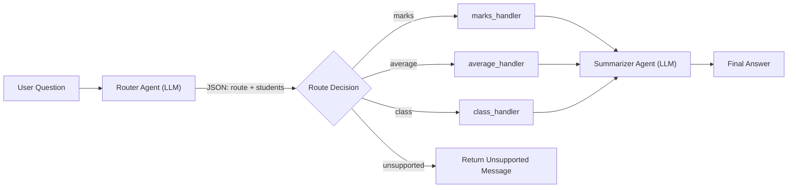

# Routing Agent: Student Grade Calculator

> [!info] Minimap
> - **Pattern:** Classify intent once → dispatch to one specialized handler → synthesize answer
> - **Flow:** `Question → Router (LLM) → Route + Entities → Specialized Handler (Python) → Summarizer (LLM) → Answer`
> - **Core Idea:** Use a lightweight LLM classifier to send each request to the exact workflow built for it (or reject out-of-scope queries early).
> - **Best For:** Well-defined, mutually exclusive request categories where each category has a clean, specialized pipeline.
> - **Trade-off:** Fast and predictable (only 1 classification call), but rigid if a single question spans multiple routes at once.

---

## Architecture



---

## Code

```python
import os
import json
from openai import OpenAI
from dotenv import load_dotenv

# --- Client & Model Setup ---
load_dotenv()  # Load NVIDIA_API_KEY from .env
client = OpenAI(
    base_url="https://integrate.api.nvidia.com/v1",
    api_key=os.getenv("NVIDIA_API_KEY")
)
MODEL = "nvidia/nemotron-3.5-lightning-30b-a3b"


# --- Minimal Stateful LLM Wrapper ---
class Agent:
    def __init__(self, system=""):
        self.messages = [{"role": "system", "content": system}]

    def __call__(self, message):
        self.messages.append({"role": "user", "content": message})
        result = self.execute()
        self.messages.append({"role": "assistant", "content": result})
        return result

    def execute(self):
        completion = client.chat.completions.create(
            model=MODEL, temperature=0.0, messages=self.messages
        )
        return completion.choices[0].message.content or ""


# --- Local Data & Deterministic Tools ---
student_marks_db = {
    "ali": [88, 92, 79, 85],
    "sara": [95, 89, 91, 87],
    "omar": [72, 65, 80, 70],
}


def student_marks(name):
    name = name.strip().lower()
    if name not in student_marks_db:
        raise ValueError(f"Unknown student: {name}")
    return student_marks_db[name][:]


def calculate_average(marks):
    return sum(marks) / len(marks)


def parse_json(response):
    # Permit a JSON code fence, but reject malformed output.
    response = response.strip()
    if response.startswith("```"):
        response = response.split("\n", 1)[1].rsplit("```", 1)[0]
    return json.loads(response)


def student_result(name):
    marks = student_marks(name)
    return {"student": name, "marks": marks,
            "average": calculate_average(marks)}


def summarize(question, results):
    # Formats handler output without inventing numbers
    agent = Agent("You are a teacher. Answer using only the supplied results. "
                  "Do not invent marks or averages.")
    return agent(json.dumps({"question": question, "results": results}))


# --- PATTERN: Router -> one specialized handler -> answer ---

def marks_handler(question, names):
    # Route 1: Return raw marks for the requested students
    return summarize(question, {name: student_marks(name) for name in names})


def average_handler(question, names):
    # Route 2: Compute individual averages (or comparisons)
    results = [student_result(name) for name in names]
    return summarize(question, results)


def class_handler(question, names):
    # Route 3: Compute individual averages plus the overall group average
    results = [student_result(name) for name in names]
    return summarize(question, {"students": results, "class_average":
        calculate_average([item["average"] for item in results])})


# Dispatch table mapping route labels to handler functions
known_routes = {"marks": marks_handler, "average": average_handler,
                "class": class_handler}


def query(question):
    # 1. CLASSIFY: Pick exactly one route and extract target student names
    router = Agent('Classify the question into exactly one route: marks (raw marks), '
                   'average (individual averages or comparisons), class (group average), '
                   'or unsupported. Return JSON only: {"route":"average", '
                   '"students":["ali"]}. Known students: ali, sara, omar. '
                   'For all students include all three names. Never invent names.')
    decision = parse_json(router(question))
    print("Routing decision:", decision)

    # 2. GUARD: Handle out-of-scope queries and validate route/entities
    route = decision["route"]
    if route == "unsupported":
        return "This question is outside the available grade workflows."
    if route not in known_routes:
        raise ValueError(f"Unknown route: {route}")

    names = decision["students"]
    if not isinstance(names, list) or not names:
        raise ValueError("No students selected")

    # 3. DISPATCH: Execute the single matching specialized handler
    return known_routes[route](question, names)


if __name__ == "__main__":
    print(query("What is Ali's average grade?"))
```

---

## How It Works (Minimap Breakdown)

1. **Classify (`router`):** Maps the question to one of 4 labels (`marks`, `average`, `class`, `unsupported`) and extracts the relevant `students`.
2. **Guard:** Rejects `unsupported` questions gracefully and raises `ValueError` for unknown routes or empty student lists.
3. **Dispatch (`known_routes[route]`):** Calls the matching Python handler (`marks_handler`, `average_handler`, or `class_handler`).
4. **Summarize (`summarize`):** Each handler delegates final wording to a grounded summarizer agent.

---

## Example Trace

```text
Routing decision: {'route': 'average', 'students': ['ali']}
Ali's average grade is 86.0 (from marks: 88, 92, 79, 85).
```

---

## Paper Reference

> [!quote] Reference
> **HuggingGPT: Solving AI Tasks with ChatGPT and its Friends in Hugging Face**
> Yongliang Shen, Kaitao Song, Xu Tan, Dongsheng Li, Weiming Lu, Yueting Zhuang (NeurIPS 2023)
> [arXiv:2303.17580](https://arxiv.org/abs/2303.17580)
>
> *Connection:* Demonstrates using an LLM controller to classify user requests and route them to specialized expert models/handlers, then summarize their outputs.
