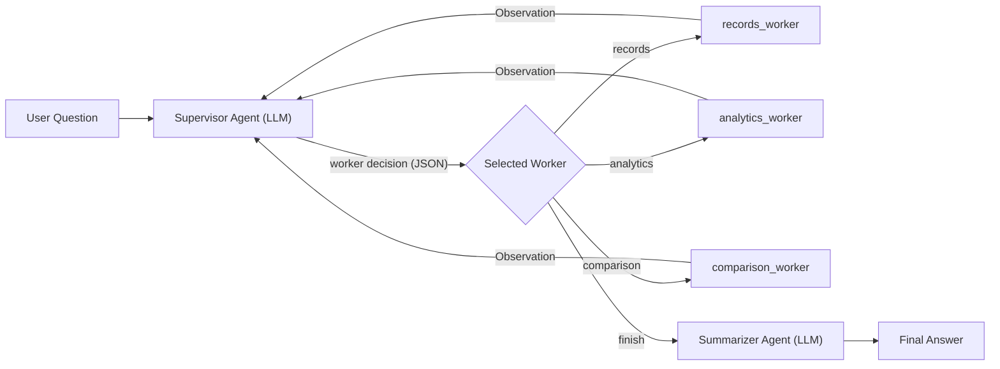

# Supervisor Agent: Student Grade Calculator

> [!info] Minimap
> - **Pattern:** Dynamic multi-turn delegation — supervisor chooses one specialist worker per turn based on prior observations
> - **Flow:** `Question → Supervisor (LLM) ⇄ Specialist Workers (records / analytics / comparison) → finish → Summarizer (LLM) → Answer`
> - **Core Idea:** Unlike a fixed upfront plan, a **Supervisor** inspects each worker's output and decides dynamically which specialist to call next—or when to finish.
> - **Best For:** Open-ended or adaptive workflows where the next specialist depends on intermediate results.
> - **Trade-off:** Highly flexible and self-correcting, but incurs an LLM decision call on every turn (bounded by `max_turns`).

---

## Architecture



---

## Code

```python
import os
import json
from openai import OpenAI
from dotenv import load_dotenv

# --- Client & Model Setup ---
load_dotenv()  # Load NVIDIA_API_KEY from .env
client = OpenAI(
    base_url="https://integrate.api.nvidia.com/v1",
    api_key=os.getenv("NVIDIA_API_KEY")
)
MODEL = "nvidia/nemotron-3.5-lightning-30b-a3b"


# --- Minimal Stateful LLM Wrapper ---
class Agent:
    def __init__(self, system=""):
        # Retains full conversation so the supervisor remembers all observations
        self.messages = [{"role": "system", "content": system}]

    def __call__(self, message):
        self.messages.append({"role": "user", "content": message})
        result = self.execute()
        self.messages.append({"role": "assistant", "content": result})
        return result

    def execute(self):
        completion = client.chat.completions.create(
            model=MODEL, temperature=0.0, messages=self.messages
        )
        return completion.choices[0].message.content or ""


# --- Local Data & Deterministic Tools ---
student_marks_db = {
    "ali": [88, 92, 79, 85],
    "sara": [95, 89, 91, 87],
    "omar": [72, 65, 80, 70],
}


def student_marks(name):
    name = name.strip().lower()
    if name not in student_marks_db:
        raise ValueError(f"Unknown student: {name}")
    return student_marks_db[name][:]


def calculate_average(marks):
    return sum(marks) / len(marks)


def parse_json(response):
    # Permit a JSON code fence, but reject malformed output.
    response = response.strip()
    if response.startswith("```"):
        response = response.split("\n", 1)[1].rsplit("```", 1)[0]
    return json.loads(response)


def student_result(name):
    marks = student_marks(name)
    return {"student": name, "marks": marks,
            "average": calculate_average(marks)}


def summarize(question, results):
    agent = Agent("You are a teacher. Answer using only the supplied results. "
                  "Do not invent marks or averages.")
    return agent(json.dumps({"question": question, "results": results}))


# --- PATTERN: Supervisor dynamically chooses workers based on their results ---
# Unlike a fixed plan, the supervisor makes a new decision every turn.

def records_worker(name):
    # Specialist 1: Fetches raw marks for a single student
    return {"student": name, "marks": student_marks(name)}


def analytics_worker(name):
    # Specialist 2: Computes marks and average for a single student
    return student_result(name)


def comparison_worker(names):
    # Specialist 3: Compares a list of students, finding highest and class average
    results = [student_result(name) for name in names]
    return {"students": results, "highest": max(results, key=lambda x: x["average"]),
            "class_average": calculate_average([x["average"] for x in results])}


# Registry of available specialist workers
known_workers = {"records": records_worker, "analytics": analytics_worker,
                 "comparison": comparison_worker}


def query(question, max_turns=10):
    # 1. SUPERVISOR: Orchestrates workers one turn at a time
    supervisor = Agent('You supervise three specialist workers. records accepts one '
                       'student name, analytics accepts one student name and computes '
                       'their average, comparison accepts a list of student names and '
                       'compares their averages. Known students: ali, sara, omar. '
                       'Choose ONE worker per turn based on observations. Return JSON '
                       'only: {"worker":"analytics","input":"ali"}. When you have '
                       'enough evidence return {"worker":"finish"}.')
    message = question
    observations = []

    # 2. ORCHESTRATION LOOP: Decide -> validate -> run worker -> feed observation back
    for turn in range(max_turns):
        decision = parse_json(supervisor(message))
        print("Supervisor:", decision)
        worker = decision["worker"]

        # Termination condition: finish only after collecting at least one observation
        if worker == "finish":
            if not observations:
                raise RuntimeError("Supervisor finished without evidence")
            return summarize(question, observations)

        if worker not in known_workers:
            raise ValueError(f"Unknown worker: {worker}")

        # Validate input shape expected by the chosen specialist
        value = decision["input"]
        if worker == "comparison":
            if not isinstance(value, list) or not value:
                raise ValueError("Comparison requires a non-empty list")
        elif not isinstance(value, str):
            raise ValueError("Worker requires one student name")

        # Execute specialist and record its output for final synthesis
        observation = known_workers[worker](value)
        observations.append({"worker": worker, "result": observation})
        print("Observation:", observation)

        # Pass the new observation back to the supervisor for the next turn
        message = json.dumps({"observation": observation})

    raise RuntimeError("Supervisor exceeded max_turns")


if __name__ == "__main__":
    print(query("Who has the highest average in the class? Explain using grades."))
```

---

## How It Works (Minimap Breakdown)

1. **Decide (`supervisor`):** Chooses one worker (`records`, `analytics`, `comparison`) or `finish` per turn in strict JSON.
2. **Validate:** Rejects unknown workers, enforces type checks (`list` for `comparison`, `str` for single-student workers), and blocks finishing with zero evidence.
3. **Observe:** Runs the chosen worker, appends its output to `observations`, and feeds the result back into `supervisor` for the next decision.
4. **Synthesize (`summarize`):** Once `worker == "finish"`, summarizes all collected `observations` into the final answer.

---

## Example Trace

```text
Supervisor: {'worker': 'comparison', 'input': ['ali', 'sara', 'omar']}
Observation: {'students': [...], 'highest': {'student': 'sara', 'marks': [95, 89, 91, 87], 'average': 90.5}, 'class_average': 82.75}
Supervisor: {'worker': 'finish'}
Sara has the highest average in the class at 90.5 (marks: 95, 89, 91, 87), ahead of Ali (86.0) and Omar (71.75).
```

---

## Paper Reference

> [!quote] Reference
> **AutoGen: Enabling Next-Gen LLM Applications via Multi-Agent Conversation**
> Qingyun Wu, Gagan Bansal, Jieyu Zhang, Yiran Wu, Beibin Li, Erkang Zhu, Li Jiang, Xiaoyun Zhang, Shaokun Zhang, Jiale Liu, Ahmed Hassan Awadallah, Ryen W. White, Doug Burger, Chi Wang (2023)
> [arXiv:2308.08155](https://arxiv.org/abs/2308.08155)
>
> *Connection:* Establishes multi-agent orchestration where a coordinating agent dynamically delegates subtasks to specialized agents and tools across turns.
